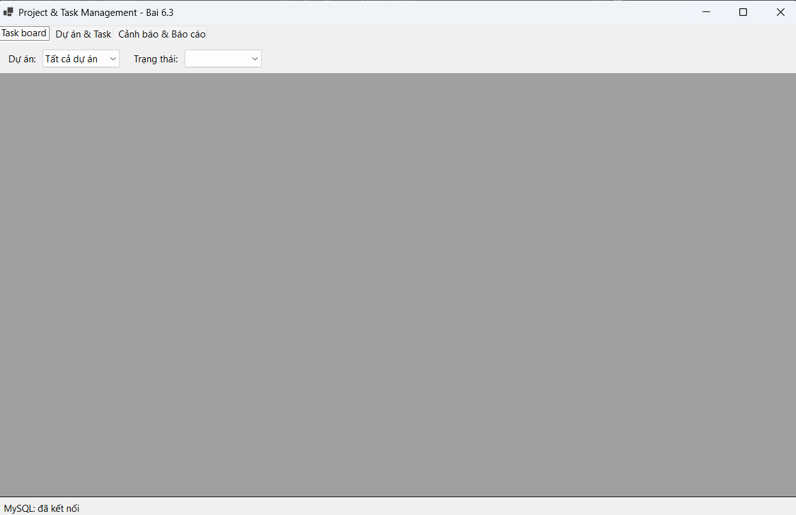
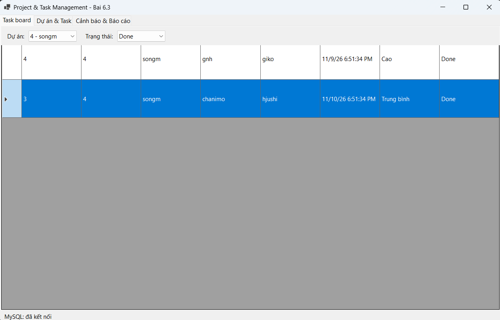
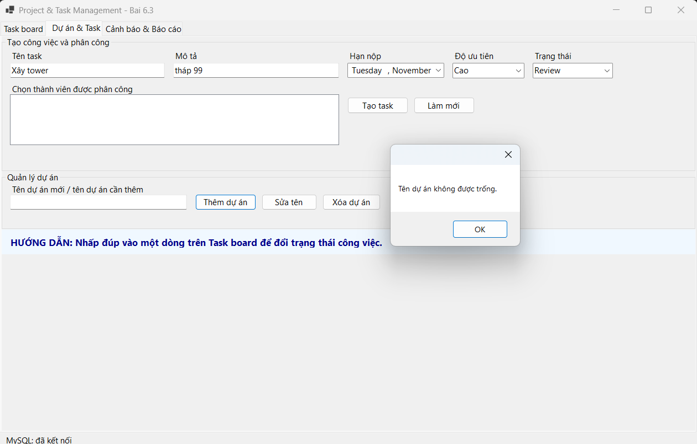
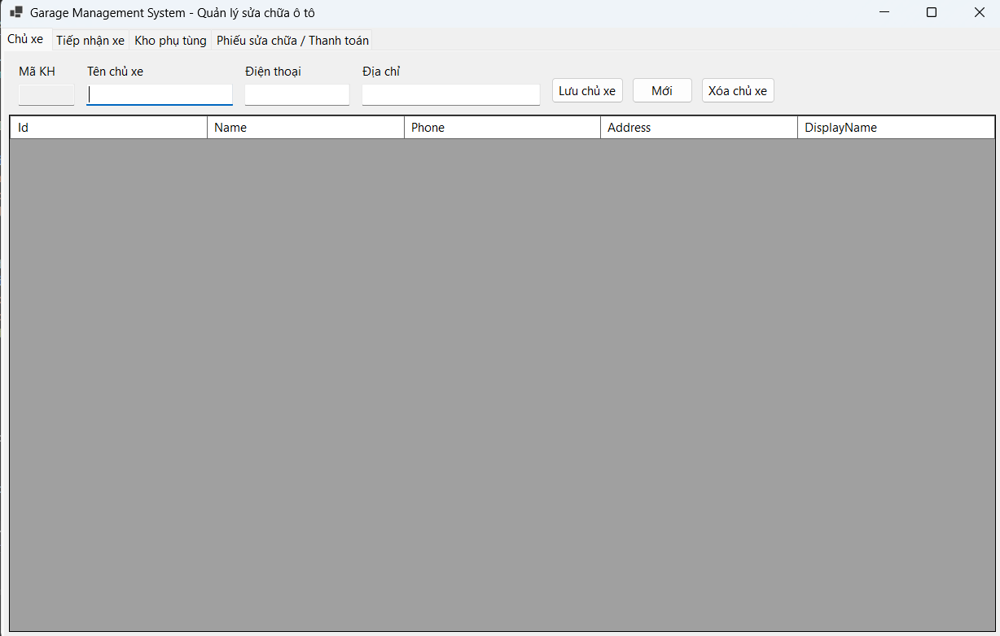
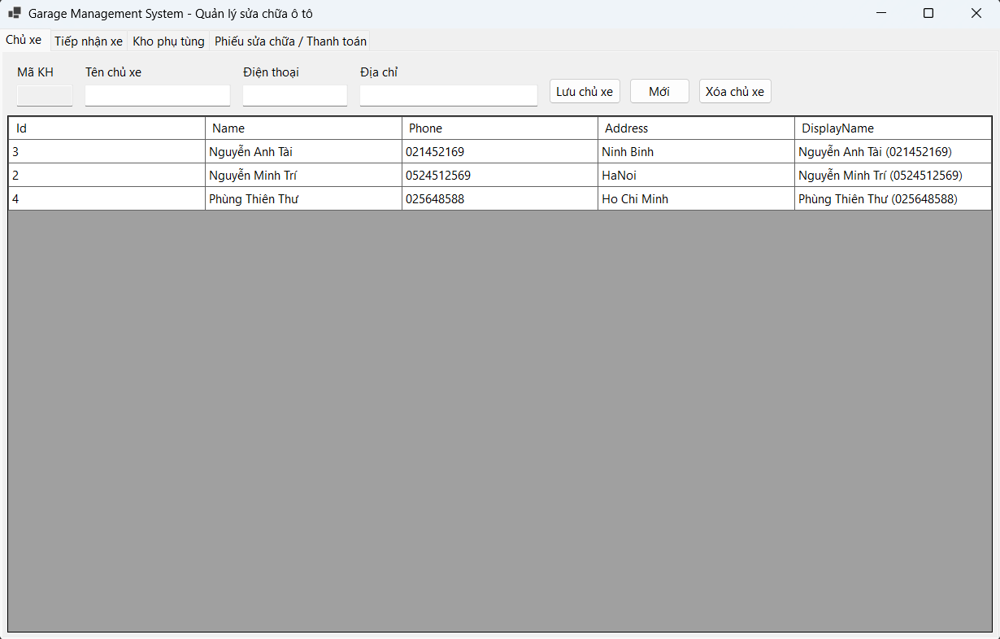
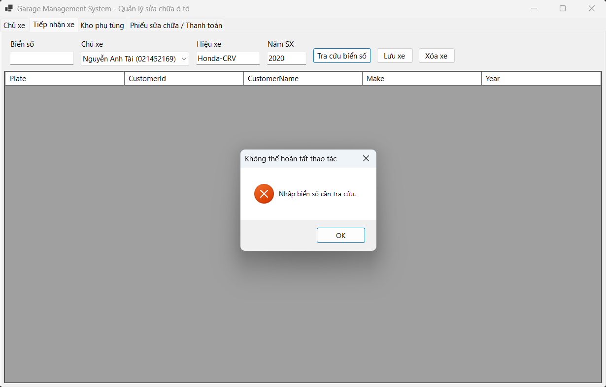
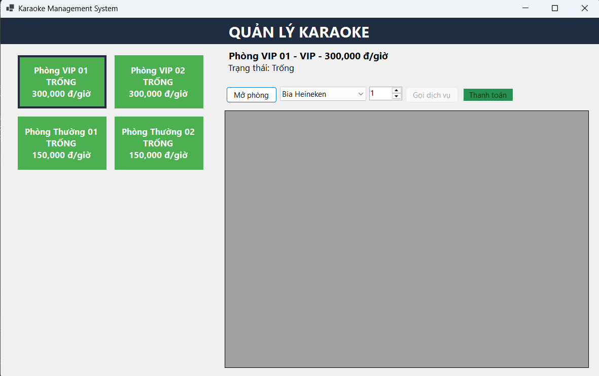
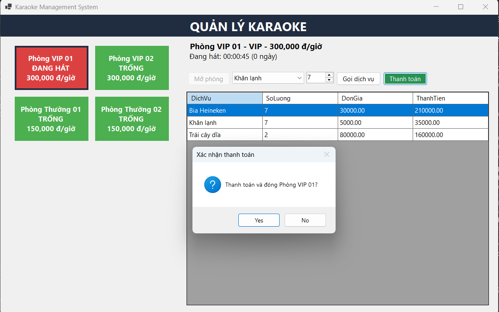

# BÁO CÁO BÀI TẬP 6.3 - 6.4 - 6.5

## I. THÔNG TIN SINH VIÊN
* **Họ và tên:** Nguyễn Minh Trí
* **Mã số sinh viên:** 24810320227
* **Lớp: D19QTANM1**
* **Lớp học phần:** Lập trình .NET 
* **Link Repository:** https://github.com/familo23/Baittap-6.3-6.4-6.5
---
## CẤU TRÚC THƯ MỤC
Mỗi bài là một Solution riêng (WinForms, .NET 10, ADO.NET + MySQL):
```
Baitap 6.3-6.4-6.5/
├── Bai6.3/                          # Quản lý dự án & công việc
│   ├── Bai6.3.slnx
│   ├── README.md                    # Hướng dẫn cài đặt chi tiết bài 6.3
│   ├── database/
│   │   └── ProjectTaskDB.sql        # Script tạo CSDL ProjectTaskDB + dữ liệu mẫu
│   └── Bai6.3/
│       ├── DTO/  DAL/  BUS/         # 3 lớp (DbConfig.cs nằm trong DAL)
│       ├── Form1.cs                 # Giao diện
│       └── Program.cs
├── Bai6.4/                          # Quản lý garage sửa xe
│   ├── Bai6.4.slnx
│   ├── README.md
│   └── Bai6.4/
│       ├── database/
│       │   └── GarageDB.sql         # Script tạo CSDL GarageDB + dữ liệu mẫu
│       ├── DAL/                     # DbConfig.cs, GarageRepository.cs
│       ├── Form1.cs
│       └── Program.cs
├── Bai6.5/                          # Quản lý karaoke
│   ├── Bai6.5.slnx
│   ├── README.md
│   ├── database/
│   │   └── KaraokeDB.sql            # Script tạo CSDL KaraokeDB + dữ liệu mẫu
│   └── Bai6.5/
│       ├── DTO/  DAL/  BUS/  GUI/   # 3 lớp + giao diện
│       └── Program.cs
├── screenshorts/                    # Ảnh chụp kết quả
└── README.md                        # Báo cáo tổng (file này)
```

---
## II. HƯỚNG DẪN CÀI ĐẶT & CHẠY DỰ ÁN
**Yêu cầu:** Windows, Visual Studio 2026 (hoặc .NET 10 SDK), MySQL Server 8.x + MySQL Workbench.

Các bước chung cho cả 3 bài:
1. Cài đặt và khởi động MySQL Server, mở MySQL Workbench và kết nối đến máy chủ (`localhost:3306`).
2. Mở và chạy (⚡ Execute) file script của bài tương ứng để tạo CSDL, bảng và dữ liệu mẫu:

   | Bài | Script | CSDL được tạo |
   |---|---|---|
   | 6.3 | `Bai6.3/database/ProjectTaskDB.sql` | `ProjectTaskDB` |
   | 6.4 | `Bai6.4/Bai6.4/database/GarageDB.sql` | `GarageDB` |
   | 6.5 | `Bai6.5/database/KaraokeDB.sql` | `KaraokeDB` |

3. Sửa chuỗi kết nối cho khớp với MySQL trên máy (tài khoản, mật khẩu, cổng) trong file `DAL/DbConfig.cs` của từng project (các bài **không dùng** `App.config`):
   - `Bai6.3/Bai6.3/DAL/DbConfig.cs` (hoặc đặt biến môi trường `PROJECT_TASK_MYSQL_CONNECTION`)
   - `Bai6.4/Bai6.4/DAL/DbConfig.cs` (hoặc đặt biến môi trường `GARAGE_MYSQL_CONNECTION`)
   - `Bai6.5/Bai6.5/DAL/DbConfig.cs`
4. Mở file `Bai6.x/Bai6.x.slnx` bằng Visual Studio. Package NuGet `MySql.Data` sẽ được tự động restore khi build.
5. Nhấn **F5** để build và chạy.

Hướng dẫn chi tiết (gồm cả MySQL và Microsoft SQL Server) nằm trong README của từng bài:
[Bài 6.3](./Bai6.3/README.md) · [Bài 6.4](./Bai6.4/README.md) · [Bài 6.5](./Bai6.5/README.md)

---

## III.  KẾT QUẢ THỰC HÀNH

### Bài 6.3
### 1. Ảnh màn hình Giao diện chính

.png)
.png)

### 2. Ảnh màn hình kết quả

---------
.png)
---------
.png)
---------

### 3. Ảnh màn hình Kiểm tra lỗi (Validation)



---
### Bài 6.4:
### 1. Ảnh màn hình Giao diện chính

---
.png)
---
.png)
---
.png)
---

### 2. Ảnh màn hình kết quả

---------
.png)
---------
.png)
---------
.png)
---------
.png)
---------

### 3. Ảnh màn hình Kiểm tra lỗi (Validation)

---
.png)


---
### Bài 6.5:
### 1. Ảnh màn hình Giao diện chính

---
### 2. Ảnh màn hình kết quả
.png)
---------
.png)
---------

---------
